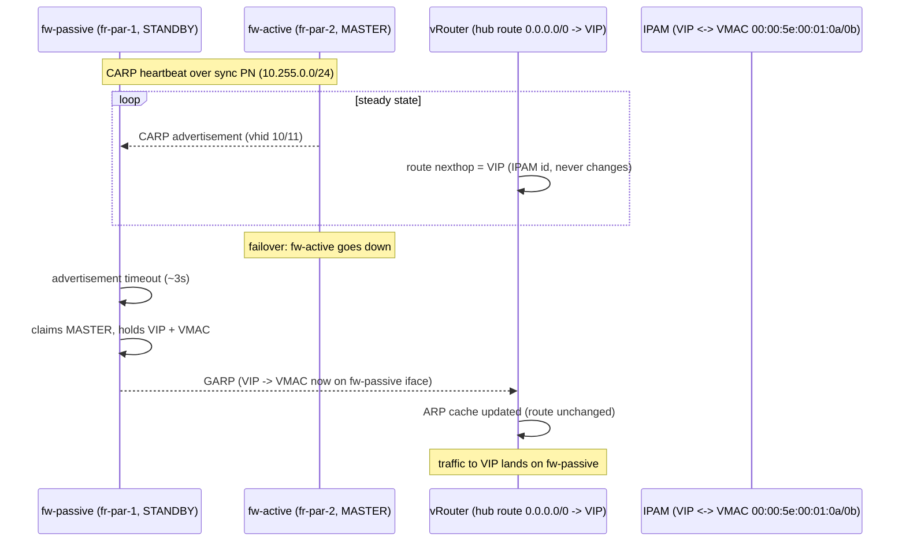

# Stage 3 - Security Appliances

Deploys the **HA OPNsense CARP pair** at the heart of the hub/spoke topology:
two private-only firewalls sharing floating CARP VIPs, managed exclusively
through a public-gateway **door** (PAT), with centralized Internet egress via
an egress Public Gateway. See `docs/opnsense-scaleway-cookbook.md` for the
deployment guide.

Full stage-3 topology (hub door, HA pair, egress plane, sync plane, all IPs) lives in the repo HLD: [`docs/Scaleway-Toolkit.drawio.xml`](../../../docs/Scaleway-Toolkit.drawio.xml), *Scaleway LDZ Toolkit HLD* page. Key facts below.

## Design

### Data plane

- **Hub/spokes are owned by Stage 2.** This stage adds the sync VPC, the HA
  pair, the CARP VIPs, the inbound door and the egress plane.
- **No public IPs on the firewalls.** `wan` (vtnet0) is `ipaddr=none` (never
  `dhcp`: a cached lease resurrects a detached public IP + `WAN_DHCP` after
  reboot). Management reaches the FWs **only** through the hub door.
- **Inbound door = the only management path.** Dual hub PGWs (active
  `10.10.0.2`, public `51.159.134.75`, fr-par-2 + passive `10.10.0.3`,
  fr-par-1) PAT-map to both firewalls with the same rule set.
  `push_default_route = false` (a platform `0.0.0.0/0` would sink instance
  routed public IPs). PAT is DNAT-only: replies must leave through the door
  the client entered, so switch to `door_ip_passive` only when the active
  dies.
- **Egress (spokes + FW-own).** Dual egress PGWs on the egress PN (active
  `10.4.0.2`, public `51.159.145.9`, fr-par-2 + passive `10.4.0.3`, fr-par-1).
  SMTP (port 25) is blocked on the PGWs unless `enable_smtp.egress: true` is
  set in the stage-3 YAML (Scaleway blocks SMTP by default to prevent abuse).
  The `hub` role stays `false` by design: it is the inbound management door
  (PAT/SSH/WEBUI) and never an SMTP egress path.
  The hub VPC routes `0.0.0.0/0 => FW CARP LAN VIP`; the FW
  policy-routes
  spoke traffic (`route-to EGRESS_GROUP`, a failover gateway group over
  [active, passive]) with hybrid SNAT to the egress VIP `10.4.0.10`, and the
  active gateway masquerades everything to its public IP. FW **own** traffic
  uses `defaultgw4 = EGRESS_GROUP`; a CARP **standby** cannot originate own
  traffic (OPNsense HA limitation), so FW-own egress is verified on the
  master only.
- **East-west is direct via the hub** - the more-specific 10.20/10.30 return
  routes beat the `0.0.0.0/0 -> FW` steering.

### HA

- CARP **vhid 10** (LAN VIP `10.10.0.10`, VMAC `00:00:5e:00:01:0a`) and
  **vhid 11** (egress VIP `10.4.0.10`, VMAC `00:00:5e:00:01:0b`): distinct
  vhids (a shared vhid = split-brain/VMAC flapping). Active = fw-active
  (fr-par-2, `advskew 0`); fw-passive (fr-par-1, `advskew 100`) is the
  standby - the hub routing plane loses 33-90% of packets to a fr-par-1
  target from a fr-par-2 source, so the active must live in the tenants' zone.
- **Dual PGW per plane (cross-AZ)** for failover via **gateway groups**
  (`EGRESS_GROUP` / `HUB_GROUP`, tier 1 = fr-par-2 active, tier 2 = fr-par-1
  passive) with dpinger monitors on the PGW LAN IPs. When the tenants' AZ
  dies the group fails the default/reply routes over automatically; the
  public egress IP changes and the door is active/passive (operator switches
  door IP). `vip_wan_mac` must match the egress vhid; pfsync runs over the
  sync PN.
- Failover sequence (advertisement timeout, MASTER claim, GARP, vRouter ARP
  refresh; the VPC route nexthop never changes):



### Routing contract (OPNsense)

- **System default = `EGRESS_GROUP`** (the FW-own egress sink above).
  OPNsense picks the highest healthy tier; without a `pgw-passive` the group
  is absent and the default is the plain `EGRESS_PGW_ACTIVE`.
- **Management reply path = per-`management_cidrs` static routes via
  `HUB_PGW_ACTIVE`**, the real active gateway. Static routes cannot reference
  a gateway group in OPNsense 26.1 (a group-named route is silently dropped,
  leaving the door dead), so door failover is a manual operator switch:
  re-point reply routes to `HUB_PGW_PASSIVE` and point clients at the passive
  door IP.
- **Gateway monitors on** (dpinger pings the PGW LAN IP); only the
  LAN_PLATFORM reference is monitor-disabled. **No `WAN_DHCP`** ever appears.

### IP plan (fixed, deterministic)

| Network | CIDR | Roles |
|---------|------|-------|
| hub PN (St.2) | `10.10.0.0/24` | CARP LAN VIP `10.10.0.10` + fw-passive `10.10.0.11` + fw-active `10.10.0.12` + hub door PGWs `10.10.0.2` / `10.10.0.3` |
| egress VPC (St.3) | `10.4.0.0/24` | egress PGWs `10.4.0.2` / `10.4.0.3` + CARP egress VIP `10.4.0.10` + fw-passive `10.4.0.11` + fw-active `10.4.0.12` |
| sync VPC (St.3) | `10.255.0.0/24` | pfsync + XMLRPC + fw-passive `10.255.0.11` + fw-active `10.255.0.12` |
| spoke-1 / spoke-2 (St.2) | `10.20.0.0/24` / `10.30.0.0/24` | egress via FW (steered); east-west direct via hub |

`.1` on each PN is reserved by Scaleway.

### Module wiring

| Module | Location | Role |
|--------|----------|------|
| `firewall-image` | `modules/firewall-image` | Prebuilt QCOW2 golden -> per-zone SBS snapshot -> SBS volume |
| `firewall` | `modules/firewall` | HA pair (`vendor`-parameterized; NIC order `vtnet0=WAN (no IP) / vtnet1=lan / vtnet2=sync / vtnet3=opt2`) |
| hub door (inline) | `main.tf` | Dual hub PGWs + gateway networks + replicated PAT rule set |
| egress plane (inline) | `main.tf` | Egress VPC/PN + dual egress PGWs + gateway networks |
| spoke steering (inline) | `main.tf` | Spoke `0.0.0.0/0 -> hub` + hub `0.0.0.0/0 -> FW CARP LAN VIP` |
| OPNsense template | `providers/opnsense/opnsense-config.xml.tftpl` | Per-node XML rendered in `main.tf` |

- **Boot image**: the 2.2 GB prebuilt golden (installed OPNsense, PNIC/UEFI
  valid) is too large for git, so the upload-wait gate fetches it at apply
  time from a local bundled file, `source_url` in the env YAML, or manual
  "UPLOAD REQUIRED" steps (see `security-appliances-<env>.yaml`).

### Firewall deploy flow (infra)

The FW infra deployment is a single chain - `make apply STAGE=3` triggers the
import script, which fetches the golden QCOW2, uploads it, imports SBS
snapshots per zone, derives volumes, and boots the firewall instances:


Editable source: [`docs/fw-mecanism.drawio.xml`](../../../docs/fw-mecanism.drawio.xml) (also available as annex in [`docs/Scaleway-Toolkit.drawio.xml`](../../../docs/Scaleway-Toolkit.drawio.xml)).

- **Config injection**: per-node XML => `user_data["opnsense_config"]`
  (OPNsense native import) + reboot. An optional `cloud-init` user-data key
  is merged beside it and delivered through **two channels** (hot apply +
  boot consumption) without ever rebuilding/rebooting the pair. See *Node
  user-data: dual-channel cloud-init* below.

### Node user-data: dual-channel cloud-init

Each firewall instance carries two user_data keys, merged without
re-rendering the XML in `modules/firewall/main.tf`:

- `opnsense_config`: the CARP XML, imported once on first boot.
- `cloud-init`: an optional `#cloud-config` fragment for per-node tweaks.
  Set it through `extra_user_data_active` / `extra_user_data_passive` in the
  env tfvars (`3-security-appliances-<env>.tfvars`, gitignored). Only
  `write_files` and `runcmd` are supported, and the content runs only when
  it changes. Leave the variable empty for none.

The fragment reaches the node through two independent channels. Both are
idempotent on a content hash:

| Channel | When | How |
|---|---|---|
| Path A, hot apply | every `apply` whose fragment changed | `null_resource.fw_extra_apply_active/passive` push it through the door with `../../../scripts/fw-extra-apply.sh` (SSH valid ports 8023/8022). The applied hash is stored in `/conf/.extra_uud_<node>.hash`. |
| Path B, boot | every node boot | the baked `/usr/local/etc/rc.syshook.d/start/99-metadata` hook reads `user_data["cloud-init"]` and runs `write_files` and `runcmd` only when its hash differs from the marker. |

When the marker already matches the desired hash, nothing runs and a second
`apply` reports "0 changed". A boot after a content change re-applies it
exactly once per node. Each run appends a timestamped line to
`/var/log/uud_ran.log` with the real node hostname; the marker files live
under `/conf/`.

Changing or removing the `cloud-init` fragment only updates the instance
user_data in place, so no FW rebuild, no reboot, no HA blip. Rebuilding the
pair happens only on a golden-image rotation: changing the image URL or
`object_key` rebuilds the snapshot and volume upstream, and the
`terraform_data` image-identity guard in `modules/firewall` then forces the
`instance_server` replacement. See *Boot image* above. All `true/false`
switches live in the env YAML, never in `main.tf`.

## Access

All management goes through the inbound door, restricted to
`management_cidrs` (use the passive door only when the active is down; see
`terraform output access | jq '.hub_pgw_door'`).

| Door URL / command | Target |
|---|---|
| `https://51.159.134.75:8443` | CARP VIP WebUI (`10.10.0.10:443`) |
| `https://51.159.134.75:8444` / `:8445` | fw-passive / fw-active WebUI |
| `ssh -i scw-lz/keys-dev/admin_key -p 8022 root@51.159.134.75` | fw-passive SSH |
| `ssh -i scw-lz/keys-dev/admin_key -p 8023 root@51.159.134.75` | fw-active SSH |

No `ping` on the FWs (no ICMP rule) - probe liveness over TCP. Out-of-band:
serial console `scw instance server console <fw-uuid> zone=<zone>`.

## Recipe

### Configuration

- **Design data** (committed): `envs/<env>/data/security-appliances-<env>.yaml`
  (zones, IP plan, `management_cidrs`, `firewall_provider`, image settings,
  test instances). **Every boolean switch lives here** - feature flags
  (`enable_smtp`, `create_test_instances`, ...) and the architecture section
  (`vpcs`, `enable_vips`, `pgws`, `firewall_module_test_instances`). Nothing
  is hardcoded as true/false in `main.tf`; the only exceptions are the
  remote-state `skip_*` validations, exposed as the `state_skip_validation`
  tfvars variable.
- **Secrets, keys, wiring** (gitignored):
  `envs/<env>/3-security-appliances-<env>.tfvars` (OPNsense/CARP passwords,
  SSH keys, S3 upload credentials, remote state access).

Topology = edit the YAML; secrets = edit the env tfvars.

### Deploy

```bash
make apply STAGE=3 [ENV=<env>]     # or terraform init/plan/apply in this dir
terraform plan                      # expect: No changes
../../../scripts/validate.sh        # repo-wide quality gate before commit
```

### Automated battery

**`./providers/opnsense/test-firewalls.sh`**: 51 checks, 12 groups, exit 0
only when all pass; parameters env-overridable (`SKIP_SCW=1` platform,
`RUN_TF=1` plan-drift). `ENV=<env> ... --ensure` re-applies the spoke
public-IP reply policy routes first (recovers blackholed public IPs).

### Test-instance public-reply policy route

A **public flexible IP + private NIC** on the same instance shadows inbound
replies via the private NIC's DHCP default (lower metric), so the platform
blackholes ALL inbound until a source-based policy route is present (it also
keeps egress on the firewall):

```bash
ip route replace default via <public-gw> dev <public-nic> table 200
ip rule add from <public-ip>/32 lookup 200 prio 1000
```

Stage-3 `test_instances` cloud-init installs this via a reboot-safe systemd
oneshot; the battery verifies it (section 5b) and `--ensure` re-applies it.

### Validation checklist (summary)

1. `terraform plan` = **No changes** on a healthy run.
2. Door: `:8443` HTTP 200; SSH `:8022` -> fw-passive, `:8023` -> fw-active.
3. HA: fw-active **MASTER** / fw-passive **BACKUP** on vhids 10 + 11.
4. Egress: `curl myip` = `51.159.145.9` from both spokes and the **master**;
   the standby times out (expected).
5. Private-only: FW `public_ips == []`; `vtnet0` has no address; no
   `WAN_DHCP`; default = `10.4.0.2`.
6. Mgmt reply routes: every `management_cidrs` prefix via `10.10.0.2` on
   **both** nodes.
7. Config.xml: EGRESS_GROUP + HUB_GROUP + both PASSIVE gateway items; passive
   door CLOSED while the active is healthy.

## Future evolution

- **Multi-vendor**: `firewall_provider` (default `opnsense`) is the extension
  point; the provider matrix and acceptance checklist live in
  **[PROVIDERS.md](PROVIDERS.md)**. Another value fails plan with a clear
  message.
- **Stage 4 CIDRs**: any CIDR a later stage peers into the hub must be added
  to the OPNsense static routes + firewall rules
  (`providers/opnsense/opnsense-config.xml.tftpl`) and a **hub return route**.

