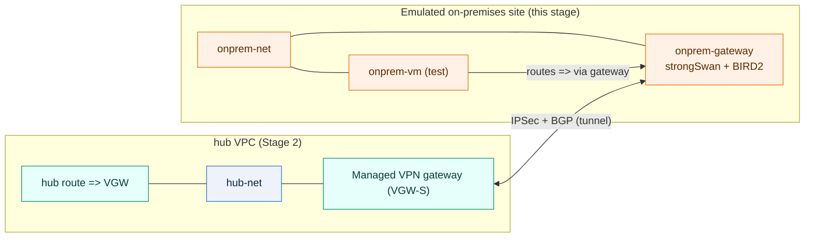

# Stage 6: Interconnection

Hybrid edge connectivity for the landing zone, in two parts:

1. **Managed Site-to-Site VPN**: moved here from Stage 2 (the networking stage now owns only the hub-and-spoke VPC core). A Scaleway managed VPN gateway on the hub Private Network, a customer gateway (remote public IP + ASN), BGP routing policies, and the IPSec/BGP tunnel. The PSK is auto-generated and stored in Secret Manager.
2. **Emulated on-premises site** (optional, gate `onprem_lab.enabled`): a dedicated `onprem` VPC whose gateway instance runs **strongSwan + BIRD2** (`modules/s2s-vpn-selfhosted`) and plays the *customer-gateway* role: it dials the managed VGW over IKEv2 and exchanges routes over BGP. A workload VM on the on-premises LAN gives you a pingable end-to-end connectivity check.



> Full landing-zone topology lives in the repo HLD: [`docs/Scaleway-Toolkit.drawio.xml`](../../../docs/Scaleway-Toolkit.drawio.xml) (*Scaleway LDZ Toolkit HLD* page) and the root README.

## How the emulated gateway boots with the right secret

The managed connection auto-generates its PSK in Secret Manager. Because the connection is created *before* the on-prem gateway instance in the same apply, Stage 6 reads the PSK back with a `scaleway_secret_version` data source and bakes it (plus the pinned VGW public IP and the VGW ASN) into the gateway's cloud-init. No post-apply step. Note the data source returns the secret as **raw base64**, so Stage 6 runs `base64decode()` on it: both gateways expect the decoded string.

The emulated gateway exposes only the tunnel (UDP 500/4500) and ICMP by default; to operate it, put your public key in `onprem_lab.gateway.ssh_keys` (rendered into cloud-init's `users` block) and your egress in `ssh_cidrs` (security-group rule for port 22).

## Resource Map

| YAML Section | Terraform Module | Description |
|---|---|---|
| `s2s_vpn_connections` | `modules/s2s-vpn` | Managed IPSec/BGP tunnels (hybrid connectivity) |
| `onprem_lab` (vpc) | `modules/vpc` | Emulated on-premises VPC + LAN |
| `onprem_lab` (gateway) | `modules/s2s-vpn-selfhosted` | strongSwan + BIRD2 customer-gateway instance |
| `onprem_lab` (vms) | `modules/instance-vm` | Workload VM on the on-premises LAN (generated cloud-init: cloud routes via the gateway + operator `admin_key`) |
| routes (derived) | `modules/vpc-route` | On-prem LAN => cloud CIDRs via the gateway |

## Usage

```bash
# Copy sample tfvars, fill in your IDs (mirror the other stages)
cp terraform.tfvars.sample ../../envs/dev/6-interconnection-dev.tfvars

# Edit the factory (SHARED with Stage 2: envs/<env>/data/networking-<env>.yaml):
# enable the lab or define a real on-prem peer
vim ../../envs/dev/data/networking-dev.yaml

terraform init
terraform plan
terraform apply
```

Production (`onprem_lab.enabled: false`): `s2s_vpn_connections` define the real remote peers (`customer_ipv4_public`, `customer_asn`, BGP tunnel IPs, prefix filters): the same story as the old Stage 2 factory, now in its own stage.

## Verify

- After apply, check `s2s_vpn_tunnel_statuses` / `s2s_vpn_bgp_statuses` outputs: a healthy tunnel shows `established` / `up`.
- From the `onprem-vm`, ping across the tunnel: `ping 10.10.0.X` (hub), `10.20.0.X` (spoke 1), `10.30.0.X` (spoke 2).
- From the hub, the on-premises LAN prefix (`10.40.0.0/24`) is reachable via the VGW's route propagation: confirm the hub VPC carries a managed `s2s_vpn` route for it (`scw vpc route list region=fr-par vpc-id=<hub-vpc>`).

## Notes

- The emulated site is a **lab**: instances, the elastic IP and the VGW reservation cost money while running. Keep it `enabled: true` in dev only.
- Each lab VM gets a generated cloud-init (from `onprem_lab.cloud_cidrs`): the cloud routes via the gateway (`<cidr> via <gateway-ip>`) and the org `admin_key` for operator access (`lzops`). The routes matter because the onprem VPC has no Public Gateway, so its PN DHCP only hands the cloud routes to the route endpoint (the gateway NIC): without them the VM cannot reach: or answer: the hub over the tunnel.
- SSH to the lab VMs is governed by `onprem_lab.cloud_ssh_cidrs` (hub/test CIDRs allowed through the tunnel, e.g. the `hub-test` agent) plus `gateway.ssh_cidrs` (operator egress). The VPN gateway itself stays operator-only.
- BGP advertises **every** lab private-network subnet (`onprem_lab.vpc.private_networks[*].ipv4_subnet_cidr`), not just the gateway's own PN: add another lab PN and the hub can reach workloads on it without touching the gateway module.
- The lab wiring is validated up front: `onprem_lab.enabled` and the `onprem_lab_peer: true` tag on an S2S connection must agree (exactly one peer while enabled, none otherwise). A mismatch fails `plan` with a clear message instead of an opaque index error.
- The PSK travels in cloud-init user data (visible to metadata holders): fine for a reference/lab; a production remote gateway would fetch its secret in-band instead.
